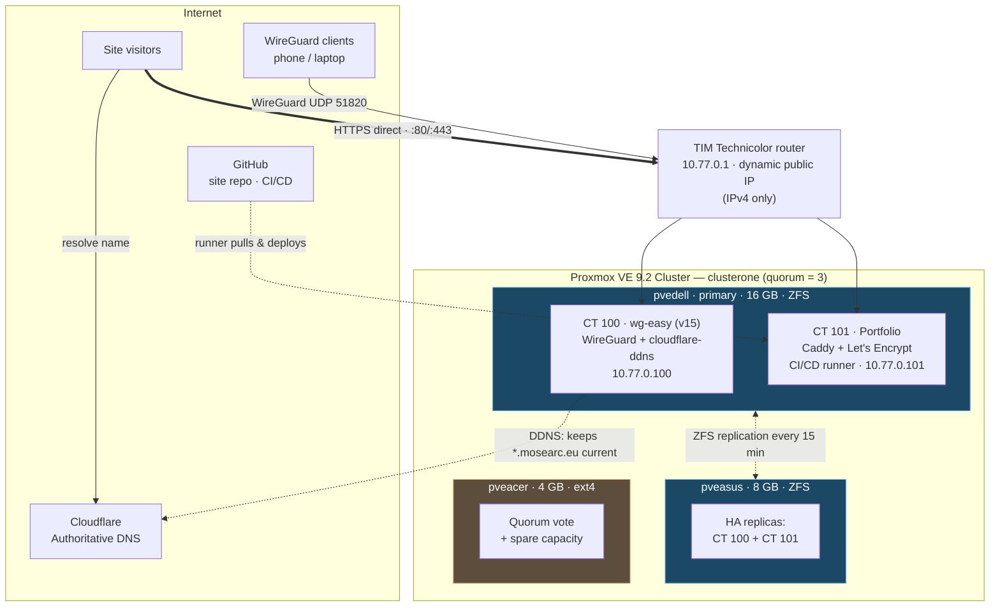

# Proxmox HA Homelab — `clusterone`

A three-node [Proxmox VE](https://www.proxmox.com/) 9.2 cluster built from recycled consumer PCs, running a public portfolio, a self-hosted WireGuard VPN, and dynamic-DNS automation — with high availability on the services that matter, despite heterogeneous hardware and no shared storage.

This repo documents **what I built and, more importantly, why**. The hardware is modest on purpose; the interesting part is the set of engineering decisions that make a reliable system out of three mismatched desktops behind a locked-down ISP router on a dynamic IP.

> **Live:** portfolio at [mosearc.eu](https://mosearc.eu) · VPN endpoint at `vpn.mosearc.eu`

---

## Architecture



<!-- VERIFY: confirm the exact RAM/disk mapping per physical machine (Dell/Asus/Acer) and the ZFS replication target before publishing. -->

---

## The cluster at a glance

| Node | Hardware | Storage | Role | Hosts |
|------|----------|---------|------|-------|
| **pvedell** | i7 (7th gen), 16 GB, 2 TB SSD | ZFS | Primary workhorse | VPN (CT 100), Portfolio (CT 101) |
| **pveasus** | i5/i7, 8 GB, 250 GB SSD | ZFS | HA replication target | Standby replicas of CT 100 & 101 |
| **pveacer** | i5 (6th gen), 4 GB, 250 GB SSD | ext4 / LVM | Quorum vote + spare capacity | — |

External 2 TB USB disk is used as an offline/rotational backup target.

> Spec-to-brand mapping is my best reconstruction — confirm against your own nodes before publishing.

---

## Services

- **Portfolio** — static site served by Caddy from CT 101, exposed directly via router port-forward (80/443) with automatic Let's Encrypt TLS. Deployed by a self-hosted GitHub Actions runner on every push to `main`. Live at `mosearc.eu`.
- **WireGuard VPN** — [wg-easy](https://github.com/wg-easy/wg-easy) v15 (Docker-in-LXC) in CT 100. Provides full remote access to the cluster and LAN from anywhere. Reached at `vpn.mosearc.eu`.
- **cloudflare-ddns** — [favonia/cloudflare-ddns](https://github.com/favonia/cloudflare-ddns) keeps `vpn.mosearc.eu` pointed at the home dynamic IP.
- **Security monitoring (planned)** — Wazuh (host/endpoint) + Suricata/Snort (network IDS). See [`docs/05-security-stack.md`](docs/05-security-stack.md).

---

## Key design decisions

The hardware forced trade-offs. These are the choices I'd defend in an interview:

- **Cluster for quorum and management, not Ceph/HA storage.** Three nodes give a clean majority vote (survive one node down). Ceph was a non-starter — the 4 GB node can't run it, and there's no fast storage network. HA instead rides on **ZFS replication**, which fits the hardware.
- **ZFS on the two capable nodes, ext4 on the 4 GB node.** ZFS enables replication and snapshots where it's needed; on the RAM-starved node its ARC cache would only compete with the workload, so ext4/LVM there.
- **HA only on the light, near-stateless services** (VPN + portfolio) with **failback disabled** — on aging hardware, auto-failback causes flapping when a recovered node is unstable. Containers fail over once and stay put until I move them back deliberately.
- **Direct self-hosted exposure for the portfolio (not a proxy or tunnel).** `mosearc.eu` is a grey-cloud DNS record pointing at the home IP; the router forwards 80/443 to the web container and Caddy obtains Let's Encrypt certs itself. Keeps the whole path self-hosted and — unlike a Cloudflare tunnel, which would encapsulate inbound traffic — leaves edge traffic inspectable for a future IDS/IPS. Trade-off: the home IP is public. (A Cloudflare tunnel was the considered alternative; chosen against, deliberately.)
- **DDNS, not a static IP.** A scoped Cloudflare API token + a hardened updater container keep the VPN endpoint resolvable through IP changes — the record is kept **unproxied** because WireGuard is UDP and can't traverse the HTTP proxy.
- **LXC over VMs everywhere possible** — far lighter on RAM, which is the binding constraint across the whole cluster.

More detail, including the mistakes and how I debugged them, in [`docs/06-lessons-learned.md`](docs/06-lessons-learned.md).

---

## Repo layout

```
.
├── README.md                     # you are here
├── docs/                         # deep-dives per component
│   ├── 01-cluster-and-ha.md
│   ├── 02-networking-dns.md
│   ├── 03-vpn.md
│   ├── 04-portfolio.md
│   ├── 05-security-stack.md      # planned
│   └── 06-lessons-learned.md
└── configs/                      # SANITISED configs (no secrets)
    ├── wg-easy/docker-compose.yml
    ├── cloudflare-ddns/docker-compose.yml
    ├── cloudflare-ddns/.env.example
    └── lxc/100-vpn.conf.example
```

## A note on secrets

Everything in `configs/` is sanitised. No API tokens, WireGuard keys, password hashes, public IPs, or MAC addresses are committed. Real secrets live only in untracked `.env` files on the hosts; see [`.gitignore`](.gitignore) and the `.env.example` templates. Internal `10.77.0.0/24` addresses are RFC 1918 private space and are safe to show.

---

*Built and documented by Mose Arcaro.*
